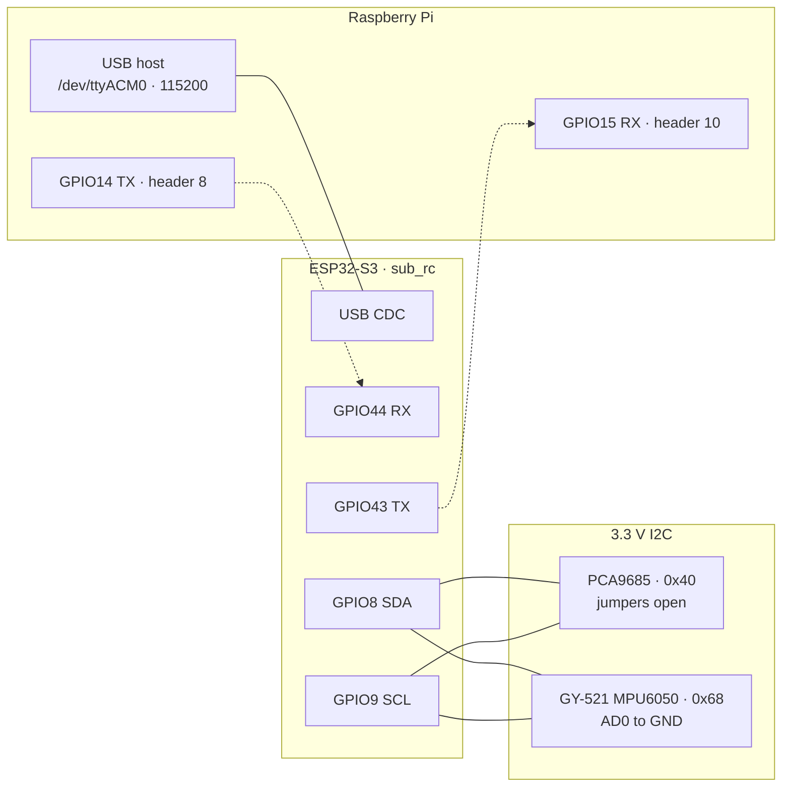
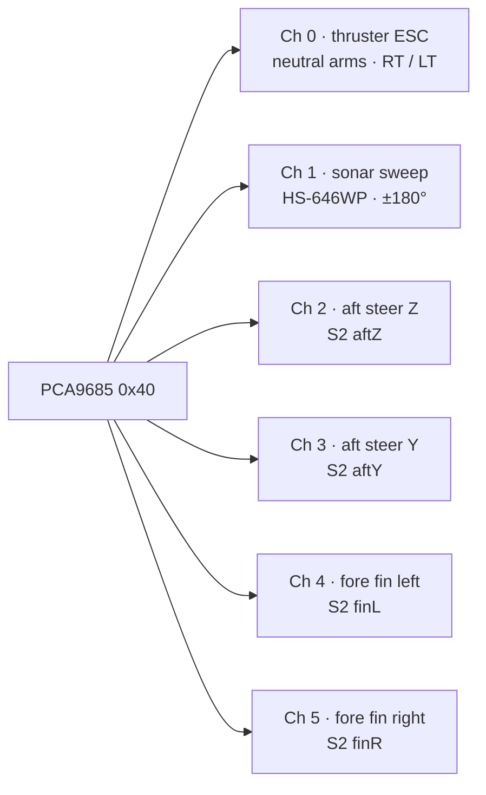

# Sub wiring

Production pin map from `esp32/sub_rc/sub_rc.ino`. The Pi talks to the ESP over USB (`USE_PI_UART` is 0). I2C is GPIO 8 and 9.



Dashed lines are the optional GPIO UART. They are compiled in, and they stay idle while `USE_PI_UART` is 0. Common ground between the Pi, ESP, PCA9685, and GY-521.

## ESP32-S3 GPIO

| GPIO | Direction | Connects to |
|------|-----------|-------------|
| USB | CDC serial | Pi `/dev/ttyACM0`, 115200. Also the flash port. |
| 43 TX | UART out | Pi GPIO15 RX, header pin 10. Only if `USE_PI_UART=1`. |
| 44 RX | UART in | Pi GPIO14 TX, header pin 8. Only if `USE_PI_UART=1`. |
| 8 | I2C SDA | PCA9685 SDA and GY-521 SDA, in parallel |
| 9 | I2C SCL | PCA9685 SCL and GY-521 SCL, in parallel |
| 16 | Out | Makerverse DIR A — fore ballast |
| 15 | PWM out, on/off | Makerverse PWM A — fore ballast |
| 6 | ADC1, 12-bit | Fore tank pot wiper (not GPIO 3 — strapping) |
| 4 | Out | Makerverse DIR B — aft ballast |
| 5 | PWM out, on/off | Makerverse PWM B — aft ballast |
| 2 | ADC1, 12-bit | Aft tank pot wiper |
| 1 | In, pulldown | 4-zone leak board, combined signal, active high |
| 10 | ADC, 12-bit | Battery sense, 0–3.3 V |
| 7 | ADC, 12-bit | Depth sense, 0–3.3 V |
| 17 | Out | Sonar TRIG (HC-SR04 or JSN-SR04T) |
| 18 | In | Sonar ECHO |

GPIO 26–32 are internal flash on this ESP32-S3. The I2C bus is GPIO 8 and 9. ADC full scale in firmware is 3.3 V (4095 counts).

## PCA9685 channels

Logic VCC is 3.3 V. Servo power is the separate 5 V rail. Address `0x40` with all address jumpers open. PWM is 50 Hz. Default pulse ticks are 150–600.



| Channel | Signal | Travel ticks | Centre tick |
|---------|--------|--------------|-------------|
| 0 | Thruster ESC | 1100–1900 µs (ticks via `escUsToTick`) | 307 ≈ 1500 µs stop |
| 1 | Sonar rotate | 150–600 | 391 |
| 2 | Aft steer Z | 150–600 | 272 |
| 3 | Aft steer Y | 207–459 | 327 |
| 4 | Fore fin left | 150–600 | 221 |
| 5 | Fore fin right | 210–345 | 258 |
| 6–15 | Unused | — | — |

Fin right is inverted in Python before the `S2` line is sent (`invert_command` on channel 5). That is not a crossed wire. Channels 2–5 are the four fin headers.

Centre and travel ticks for channels 2–5 come from `config/pins.yaml`. Channel 1 uses the firmware default centre (tick 391, about 96.5°).

## Motors and sensors

**Thruster, Blue Robotics Basic ESC on PCA channel 0.** Signal wiring: white → ch0, black → common ground. GPIO 13, 12, and 6 are not the thruster. Full stack (PWM timing, arming gate, Pi `S2` / Xbox RT·LT, dashboard telemetry) is documented in **[THRUSTER_ESC.md](THRUSTER_ESC.md)**.

**Ballast, Makerverse 2-channel, DIR/PWM.** Each tank uses a **10 kΩ linear** pot on the linkage (rotary B10K or slide, e.g. SparkFun **COM-11620** / TE **C2031N-B10K**, 20 mm slide) plus three driver wires (DIR, PWM, GND).

**10 kΩ linear pot wiring (3.3 V only — not 5 V):**

| Pot terminal | Connect to |
|--------------|------------|
| End tab A | ESP **3.3 V** |
| End tab B | ESP **GND** |
| Wiper tab | ESP ADC GPIO below |

**Finding the wiper on a slide pot (three solder tabs):** With the pot **unpowered**, meter on **Ω** between each pair of tabs. The two **end** tabs read ~**10 kΩ** fixed (±20%). The **wiper** is the tab that reads **changing** resistance to an end tab as you move the slider; at one travel end wiper-to-end ≈ 0 Ω, at the other ≈ 10 kΩ. Do **not** guess “middle tab” without checking — pegged ADC (0 V or 3.3 V on the dashboard) usually means the wiper wire is on an **end** tab or on **DIR/PWM**.

Moving the slider should sweep the ADC from near **0** to near **4095** (12-bit). At the physical end stops, 0 % or 100 % raw is normal.

| Tank | DIR | PWM | Pot wiper (ADC) | Fill (+1) | Drain (−1) | Stop (0) |
|------|-----|-----|-----------------|-----------|------------|----------|
| Fore | GPIO 16 | GPIO 15 | **GPIO 6** | DIR high, PWM on | DIR low, PWM on | PWM off |
| Aft | GPIO 4 | GPIO 5 | **GPIO 2** | DIR high, PWM on | DIR low, PWM on | PWM off |

**Common wiring mistakes (stuck at 0 or 4095):**

- Pot wiper on **GPIO 15 or 16** (fore DIR/PWM) or **4/5** (aft DIR/PWM) — those pins are driven **HIGH/LOW**, not analog.
- Fore wiper on **GPIO 3** — **strapping pin** (avoid). Use **GPIO 6** (ADC1). GPIO 14 is ADC2 / easy to confuse with **Pi GPIO 14**.
- Aft wiper still on **GPIO 3** or **battery on GPIO 2** from an older map — firmware reads aft on **GPIO 2** only; battery divider belongs on **GPIO 10**.
- Outer pot legs on **5 V** or swapped so the wiper is shorted to rail.
- **Charge-only** or broken ground — wiper floats and can peg high or low.

Bench check: dashboard **TEST A** or serial `TEST A` → `fore_adc` / `aft_adc` should sweep when you turn each B10K. Boot line `OK ballast pots fore_gpio=6 adc=…` should not sit at 0 and 4095 on both unless a shaft is at an end stop.

**Fore vs aft on the HUD:** **FORE** = pot GPIO **6**, **AFT** = GPIO **2**. Move **only** the aft slide pot and watch serial `TEL ballast aft …` — `fore_adc` must stay flat. If **FORE** (blue fill) moves instead, the aft pot wiper is probably on **GPIO 6** (or tank labels are swapped vs the HUD). Reflash with `BALLAST_POT_GPIO_SWAP 1` in `sub_rc.ino` or move the wiper wire.

**Pump vs pot:** The vertical **slider** is fill/drain **command** (both tanks can run together on Xbox RB/LB without D-pad — see `default_tank: both` in `config/xbox_mapping.yaml`). The **blue fill** behind the slider is **pot level** from telemetry only.

**Strapping pins (ESP32-S3):** GPIO **0**, **3**, **45**, **46** — do not wire pots or strong dividers that hold these rails at boot. GPIO 2 (aft pot) is not a strapping pin; keep B10K on **3.3 V** only.

**Leak.** One wire to GPIO 1. Any of the four zones (fore, aft, electronics, battery) drives that line high. The pin has an internal pulldown.

**Sonar.** TRIG GPIO 17, ECHO GPIO 18, max range 6 m. The head is rotated by PCA channel 1.

**IMU.** GY-521 on the same I2C bus, address `0x68`, AD0 tied to GND.

## Raspberry Pi GPIO (local)

These pins are on the **Pi**, not the ESP32.

| GPIO | Connects to | Behavior |
|------|-------------|----------|
| 18 | Relay module **IN / RCIN** (signal) | Leak / fault annunciator — see **[RELAY_G5LE.md](RELAY_G5LE.md)** |

**Omron G5LE-14** (or module built around it): coil via driver board; LEDs on **COM + NC**. Full pinout, module wiring, and `hardware.yaml` settings are in **[RELAY_G5LE.md](RELAY_G5LE.md)**.

| State | Coil | NC path | LEDs |
|-------|------|---------|------|
| OK | **energized** | open | **off** |
| `TEL leak` or `TEL fault` | **released** | closed | **on** |

Configured in `config/hardware.yaml` (`fault_indicator`). Updates on **`TEL leak` / `TEL fault`** only. Logs once at boot (`drive_ok=True` means `gpioset` is holding the line).

**Manual test on Pi OS (use `pinctrl`, not `gpioset`, on Pi 5):**
```bash
pinctrl get 18
pinctrl set 18 op dh    # drive HIGH — NC LEDs should go off
pinctrl set 18 op dl    # drive LOW  — NC LEDs should turn on
```
`~/sub` uses `backend: pinctrl` in `hardware.yaml` (boot log: `BCM18 (pinctrl, …)`).

ESP sonar **ECHO** is GPIO **18 on the ESP**, not this Pi pin.

## Pi USB that is not on the ESP

Cameras and the GPS dongle plug into the Pi USB ports. They do not use ESP or PCA pins. Camera paths are in `config/hardware.yaml`.

## Older maps

`esp32/sub_hw_test/sub_hw_test.ino` is an older bench pinout and does not match this vehicle. Runtime pinout is `esp32/sub_rc/sub_rc.ino` and `config/pins.yaml`.
